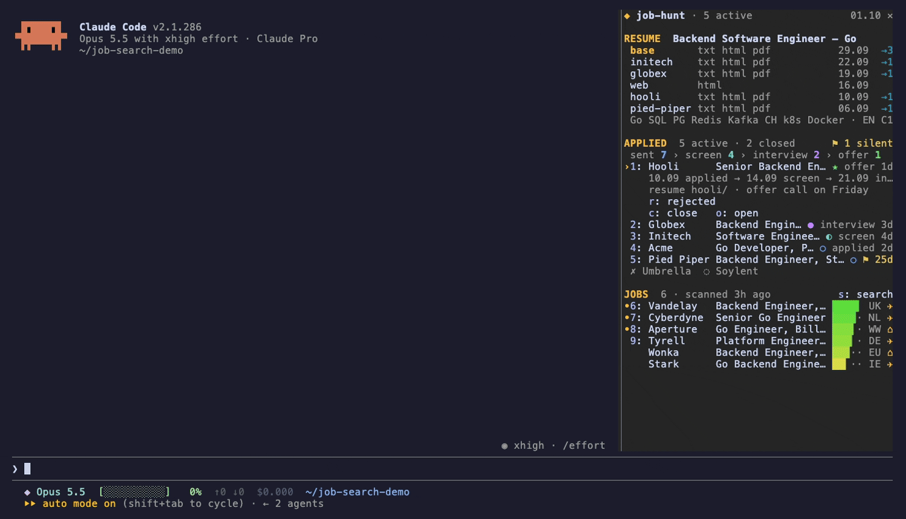

# job-hunt

**Your job search, docked next to Claude Code.** Track every application, let Claude find jobs that fit your resume, and tailor the resume for each company. Everything stays in plain JSON in your own folder.



## Install

At the Claude Code prompt:

```
/plugin install job-hunt --marketplace vlle/job-hunt-cc
```

Answer `y` to add the marketplace, then pick a scope: **user** loads it in every session. From a shell it is `claude plugin install job-hunt --marketplace vlle/job-hunt-cc`. In the desktop app, click **+** next to the prompt box, then **Plugins**, **Add marketplace** with `vlle/job-hunt-cc`, then **Add plugin**.

You need Claude Code 2.1.300 or later (`claude --version`, `claude update`).

## Try it in 10 seconds

```
/hunt demo
```

The panel opens with a made-up search: seven applications at every stage, a silent one flagged, six ranked jobs. Nothing is written. Run `/hunt demo` again, or press `p` in the panel, to switch back.

## Start for real

1. Open a terminal in the folder with your resume (any empty folder works too) and run `claude`.
2. Type `/hunt init`. Claude finds your resume (PDF, DOCX, Markdown or a LinkedIn export) and writes `resume.txt`, using only facts from it. Already have a `resume.txt`? Skip this step: the panel opens on its own.
3. Press `s` in the panel. Claude searches the web for jobs that match your resume, opens each posting to check it is still open, and ranks the results by fit.
4. Press `a` on a job once you have applied, and `n` when a company moves you forward. Or just tell Claude: *"Acme invited me to an interview"*.

## What the panel shows

- **RESUME**: your resume and its tailored copies, their formats, when each was last edited and how many applications used it.
- **APPLIED**: the funnel `sent › screen › interview › offer`, one row per active application with its stage and age. A `⚑` flags any company that has been silent for 21 days.
- **JOBS**: openings Claude found for you, ranked by how well they fit your resume. `⌂` marks a fully remote job you can do from your country (as an employee, contractor, B2B or through an EOR); `✈` marks explicit visa sponsorship or relocation.

Searching and tailoring are ordinary Claude turns that the panel queues for you, so they use your session's own tools (web search, scrapers, MCP servers). When a search finishes you get a notification through your terminal's channel (iTerm2, kitty, Ghostty or a bell), the same way Claude Code notifies you. The mod itself only reads and writes a few files in your folder.

## Keys and commands

| Key | Where | What it does |
| --- | --- | --- |
| `1`–`9` | panel | select a row |
| `j` / `k`, arrows | panel | move the selection (after clicking into the panel) |
| `s` | panel | ask Claude to search for jobs |
| `a` | job | log an application: the job moves to APPLIED |
| `t` | job | ask Claude to tailor the resume for this job |
| `x` | job | hide the job |
| `o` | job or application | open the posting in the browser |
| `n` | application | move to the next stage |
| `r` / `c` | application | mark as rejected / close |
| `p` | panel | swap in made-up demo data (for screenshots), and back |

`/hunt` opens the panel. The same actions work by row number: `/hunt init`, `/hunt demo`, `/hunt scan`, `/hunt apply 3`, `/hunt tailor 3`, `/hunt hide 3`, `/hunt open 3`, `/hunt next 1`, `/hunt reject 1`, `/hunt close 1`.

**Search** (`s`) asks Claude to find up to 20 jobs that match your target, check that each posting still accepts applications, skip companies you already applied to, and save the result. Jobs found in the last three days get a `•`; jobs older than 30 days drop out.

**Tailor** (`t`) asks Claude to create a `<company>/` folder modelled on your latest tailored copy, using only verified facts, and to list the requirements your resume does not cover. It does not log the application: press `a` once you have sent it.

Claude can also call the mod's tools directly whenever you mention your search:

| Tool | What it does |
| --- | --- |
| `mcp__job-hunt__save_leads` | merges found jobs into `hunt/leads.json` by url |
| `mcp__job-hunt__log_application` | logs an application; a repeat for the same company and role, or the same url, updates it |
| `mcp__job-hunt__set_stage` | moves an application to `screen`, `interview`, `offer`, `rejected` or `closed` |

## Configuration

Set these in `/config` (each one is a row there) or under `pluginConfigs` in your settings:

| Option | Default | Used for |
| --- | --- | --- |
| `target` | roles that match the resume: abroad with visa sponsorship or relocation, or fully remote from my country | what the search looks for, in one line. It also sets the balance between remote and relocation (`fully remote; relocation only with sponsorship, as a fallback`) and any contract form you need |
| `exclude` | empty | kinds of jobs the search skips, e.g. `staff/lead roles, frontend, internships` |
| `facts` | `CLAUDE.local.md` | a file in your folder with verified facts beyond the resume; search and tailoring may use only these and the resume |
| `layout` | `one list` | how JOBS is shown: `one list` by fit, or `relocate first` / `remote first` for two groups; row numbers follow what you see |

## Your folder

```
my-job-search/
├── resume.txt            required: marks the folder; the panel reads your profile from it
├── resume.html, *.pdf    optional formats of the base resume
├── resume-web.html       resume-<name>.txt|html|md in the root is a variant called <name>
├── acme/                 a tailored copy per company: resume.* and a PDF
├── CLAUDE.local.md       optional verified facts beyond the resume (see `facts`)
└── hunt/
    ├── applications.json written by the mod and its tools
    └── leads.json        written by save_leads
```

The panel takes the first three non-empty lines of `resume.txt` as your name, title and contacts (the first contact, split on `·`, `•` or `|`, is your location). It also reads the first three `Key: a, b, c` rows under a `SKILLS` heading and an `English (C1)` style level. A resume in another shape still works; the panel just shows less.

## Privacy

- The mod has no network access of its own. It reads your resume files and reads and writes `hunt/*.json`, nothing else.
- Search and tailoring run as normal turns in your session, with your model, your tools and your plan's usage.
- Installed for every session, the mod stays out of the way: outside a folder with `resume.txt` it adds only the `/hunt` command, with no tools and no panel.
- Every write re-reads the file first, and a file that is not valid JSON is never overwritten. Hidden jobs are remembered in `applications.json`, so a new search does not bring them back.

## FAQ

**The panel did not open.** It opens by itself on a terminal at least 144 columns wide. Below that, type `/hunt`. After you have opened it once, it docks by itself from 110 columns. On a narrower terminal it sits above the prompt.

**Does it work in the desktop app?** Yes: the panel draws in the terminal and in the desktop app's Code tab.

**Does it apply for me?** No. It finds, ranks and tailors; you read the posting and press send.

## Development

```sh
git clone https://github.com/vlle/job-hunt-cc.git && cd job-hunt-cc
claude plugin validate .
claude plugin test .
claude --plugin-dir .        # hot reload; also lays the API types in .claude-plugin/types/
npx -p typescript tsc -p .   # TypeScript 5.4+, after one interactive run above
```

- `hooks/register.tsx`: hooks, tools, file I/O and the session state (`$.state` atoms)
- `hooks/hunt.ts`: pure logic (tracker, jobs, funnel, variants, prompts)
- `hooks/panel.tsx`: the panel, a client module
- `hooks/demo.ts`: the made-up data for `/hunt demo`
- `types/index.d.ts`: the state contract

## License

[MIT](LICENSE)
